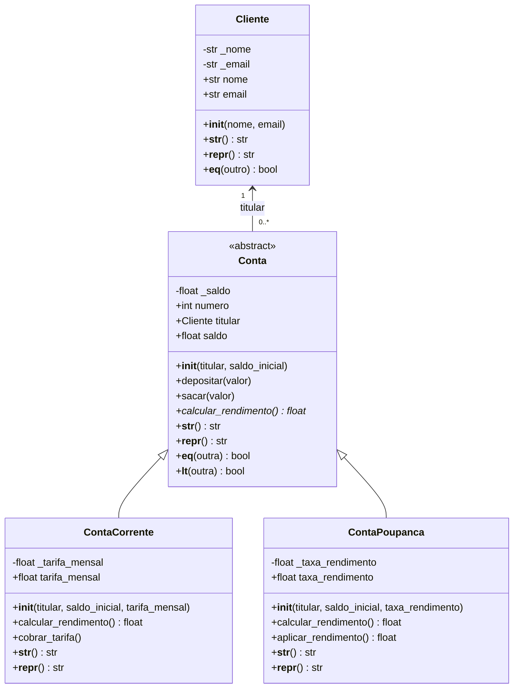

# Sistema Bancário — Programação Orientada a Objetos

Projeto didático em Python que demonstra classes, objetos, encapsulamento, herança, polimorfismo, classe abstrata, métodos especiais e tratamento de exceções.

**Repositório:** `https://github.com/SEU-USUARIO/NOME-DO-REPOSITORIO` *(substitua pelo link real)*

## Requisitos

- Python 3.8 ou superior.
- Nenhuma biblioteca externa é necessária.

## Como executar

No terminal, dentro da pasta do projeto, execute:

```bash
python main.py
```

## Diagrama de classes



## Decisões de modelagem

### Herança: `Conta` → `ContaCorrente` e `ContaPoupanca`

Uma conta corrente **é uma** conta, e uma poupança **é uma** conta. Ambas compartilham número, titular, saldo, depósito e saque, e diferem apenas no cálculo do rendimento e em atributos próprios (tarifa e taxa). A herança evita repetir o código comum e permite tratar qualquer conta de forma uniforme, por exemplo em uma lista com tipos misturados.

`Conta` é **abstrata** porque não existe "conta genérica" no mundo real: toda conta é de algum tipo. O método abstrato `calcular_rendimento()` obriga cada filha a definir sua própria regra. As filhas reutilizam o construtor da mãe com `super().__init__(...)`.

### Composição/associação: `Conta` → `Cliente`

Uma conta **tem um** titular. Herdar de `Cliente` não faria sentido, pois uma conta não é um cliente. Por isso, a conta guarda uma **referência** a um objeto `Cliente`, em vez de duplicar nome e e-mail. Isso traz duas vantagens: os dados do cliente ficam em um único lugar e o mesmo cliente pode ter várias contas (por exemplo, uma corrente e uma poupança).

### Por que não usar só composição?

Seria possível ter uma classe `Conta` única com um objeto "estratégia de rendimento" dentro dela. Essa alternativa é válida e flexível, mas, para este domínio pequeno e com apenas dois tipos fixos, a herança é mais simples, mais direta e deixa explícita a relação "é um". Em um sistema com muitos tipos ou regras que mudam em tempo de execução, a composição passaria a ser a melhor escolha.

### Polimorfismo

As duas classes filhas implementam `calcular_rendimento()` de formas diferentes. Na conta corrente, o resultado é sempre zero; na poupança, é o saldo multiplicado pela taxa configurada. Quem chama o método não precisa saber qual é o tipo da conta.

### Encapsulamento

Os valores sensíveis (`nome`, `email`, `saldo`, `tarifa_mensal`, `taxa_rendimento`) são guardados em atributos internos com prefixo `_` e acessados por `@property`, com validação nos setters.

> **Limitação conhecida:** `numero` e `titular` são atributos públicos simples, sem `@property`. O titular é validado apenas no construtor (`isinstance(titular, Cliente)`). Uma evolução natural seria transformá-los em propriedades somente leitura.

## Validações com `@property`

| Propriedade | Regra aplicada | Exceção |
|---|---|---|
| `Cliente.nome` | Deve ser texto não vazio; espaços nas pontas são removidos | `ValueError` |
| `Cliente.email` | Deve seguir o formato `texto@dominio.ext`; é normalizado para minúsculas | `ValueError` |
| `Conta.saldo` | Deve ser numérico (booleanos são rejeitados) e não pode ser negativo | `TypeError` / `ValueError` |
| `ContaCorrente.tarifa_mensal` | Deve ser numérica e não negativa | `TypeError` / `ValueError` |
| `ContaPoupanca.taxa_rendimento` | Deve ser numérica e estar entre `0` e `1` (0% a 100%) | `TypeError` / `ValueError` |

Como as atribuições passam pelos setters, inclusive dentro do `__init__`, não é possível criar um objeto com esses atributos em estado inválido.

Os métodos `depositar` e `sacar` também validam os valores: rejeitam quantias não numéricas ou não positivas e saques acima do saldo.

## Métodos especiais

- `__init__`: inicializa os objetos.
- `__str__`: exibe uma representação amigável ao usuário.
- `__repr__`: fornece uma representação técnica. Nas contas, ela mostra o saldo atual como `saldo_inicial`, então não reproduz o número da conta (que é gerado automaticamente).
- `__eq__`: compara clientes pelo e-mail e contas pelo número.
- `__lt__`: permite ordenar contas pelo saldo, por exemplo, com `sorted(contas)`. Duas contas com o mesmo saldo não são consideradas iguais (`__eq__` usa o número), mas nenhuma é menor que a outra.

## Exemplos de uso

```python
from main import Cliente, ContaCorrente, ContaPoupanca

# Criando objetos
ana = Cliente("Ana Souza", "ana@email.com")
corrente = ContaCorrente(ana, 1000, tarifa_mensal=12)
poupanca = ContaPoupanca(ana, 2000, taxa_rendimento=0.01)

# Operações
corrente.depositar(200)
corrente.sacar(50)
corrente.cobrar_tarifa()
poupanca.aplicar_rendimento()

print(corrente)
# ContaCorrente nº 1001 | Titular: Ana Souza | Saldo: R$ 1138.00 | Tarifa mensal: R$ 12.00

# Polimorfismo: mesma chamada, resultados diferentes
for conta in (corrente, poupanca):
    print(conta.numero, conta.calcular_rendimento())
# 1001 0.0
# 1002 20.2

# Ordenação pelo saldo (__lt__)
for conta in sorted([poupanca, corrente]):
    print(conta.numero, conta.saldo)

# Tratamento de exceções
try:
    corrente.sacar(999999)
except ValueError as erro:
    print(erro)  # Saldo insuficiente.

try:
    Cliente("Pessoa", "email-invalido")
except ValueError as erro:
    print(erro)  # E-mail inválido. Exemplo: nome@email.com

try:
    ContaPoupanca(ana, 100, 1.5)
except ValueError as erro:
    print(erro)  # A taxa deve estar entre 0 e 1.
```

## Testes e demonstração

Ao executar `main.py`, o programa:

1. Cria 10 clientes e 10 contas (5 correntes e 5 poupanças).
2. Exibe as contas cadastradas.
3. Percorre uma lista de contas de tipos diferentes para demonstrar polimorfismo.
4. Realiza depósitos, saques e aplicação de rendimento.
5. Ordena as contas pelo saldo e exibe as três menores.
6. Mostra a representação técnica de uma conta.
7. Executa operações inválidas e trata as exceções com `try/except`.

### Saída esperada (trechos)

```text
=== SISTEMA BANCÁRIO ORIENTADO A OBJETOS ===

--- Contas cadastradas ---
ContaCorrente nº 1001 | Titular: Ana Souza | Saldo: R$ 1200.00 | Tarifa mensal: R$ 10.00
ContaPoupanca nº 1002 | Titular: Bruno Lima | Saldo: R$ 2000.00 | Taxa: 1.00% | Rendimento previsto: R$ 20.00
...

--- Demonstração de polimorfismo ---
Ana Souza: rendimento calculado = R$ 0.00
Bruno Lima: rendimento calculado = R$ 20.00
...

--- Operações bancárias ---
Saldo após depósito e saque: R$ 1250.00
Saldo da poupança após rendimento: R$ 2020.00

--- Testes de validação e exceções ---
E-mail inválido: tratado corretamente — E-mail inválido. Exemplo: nome@email.com
Saldo negativo: tratado corretamente — O saldo não pode ser negativo.
Depósito negativo: tratado corretamente — O valor deve ser maior que zero.
Saque acima do saldo: tratado corretamente — Saldo insuficiente.
Taxa inválida: tratado corretamente — A taxa deve estar entre 0 e 1.

Demonstração concluída.
```

> Observação: este é um exemplo didático. As taxas e tarifas são ilustrativas e não representam condições de uma instituição financeira real.
